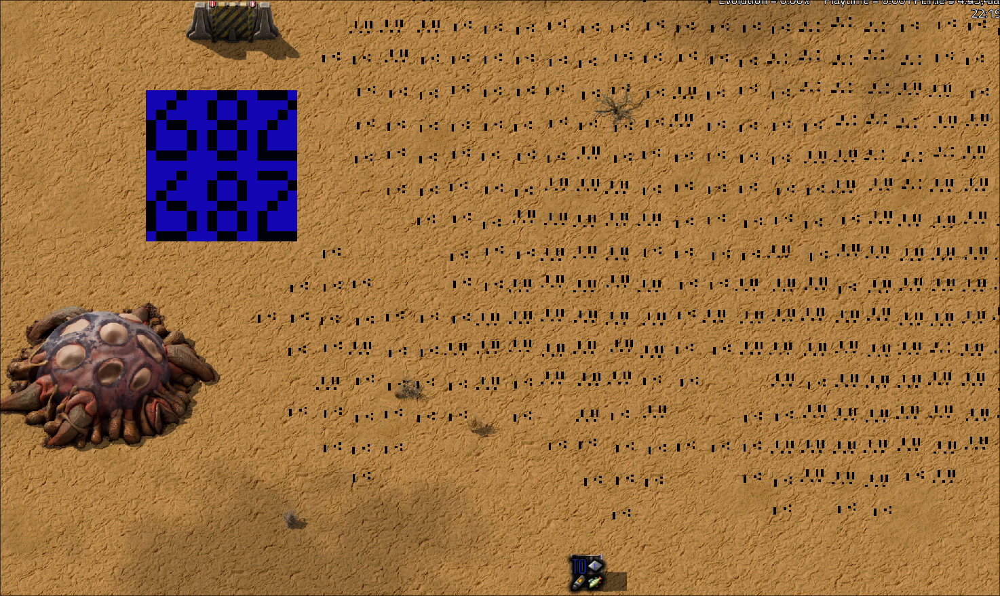

# scps
A factorio mod that adds in a few diffrent scps and the stuff to contain them.
## What it adds
- 2 new wall types and 1 new gate
- a powerful fuel source
- titanium ore and plates
- a powerful new enemy with a drop that is used for the fuel source.
- a spawner for the enemy
## How to use
Use the in game mod manager to install the mod: SCPs
## Why i made it
I wanted to make a mod for factorio that added a few diffrent scps because i am a fan of the SCP wiki and all of the work the authors have put into writing the stories that they have. i have gone with scp-682 for now because it is a pretty simple scp to implement and it is a pretty well know one. i have also added scp-022-j because it is really easy to add and it is a funny joke.
## screenshots

## Licencing
all the scps used are recreated as closly a i can make them from the original scps
"[SCP-682]( https://scpwiki.com/scp-682)" by Dr Gears and Epic Phail Spy, from the SCP Wiki. Source: https://scpwiki.com/scp-682. Licensed under [CC BY-SA](https://creativecommons.org/licenses/by-sa/3.0/).
"[SCP-022-J](https://scp-wiki.wikidot.com/scp-022-j)" by DisaffectedFeline, from the SCP Wiki. Source: https://scpwiki.com/scp-022-j. Licensed under [CC BY-SA](https://creativecommons.org/licenses/by-sa/3.0/).
